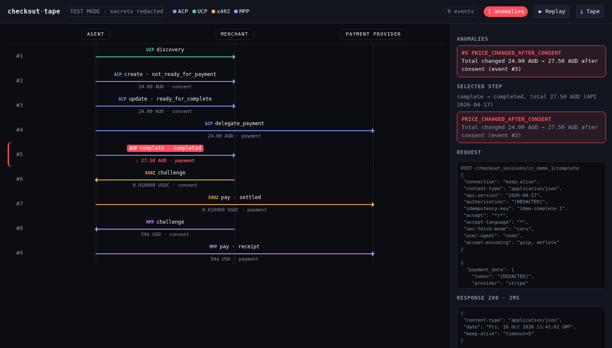

# checkout-tape

**Wireshark for agent checkouts.** A local proxy and live timeline that records what your AI agent, the merchant and the payment provider say to each other across **ACP**, **UCP**, **x402** and **Stripe MPP**, and flags the step where something went wrong. The main check: *the price changed between consent and payment.*

[](LICENSE) 



> Screenshot of `checkout-tape demo`. In the live UI the anomaly row flashes red. An animated GIF is still to come.

## Install / run

One command, zero setup (mock agent + mock merchant):

```bash
npx github:ashark-ai-05/checkout-tape demo
# open http://localhost:8403
```

It isn't on npm yet. Once it's published, this becomes `npx checkout-tape demo`.

Record your own agent:

```bash
npx github:ashark-ai-05/checkout-tape --upstream https://your-merchant.test --port 8402
# point your agent's merchant base URL at http://localhost:8402
# timeline: http://localhost:8403   tape: checkout-tape-<ts>.jsonl
```

Other commands:

```bash
checkout-tape replay tape.jsonl            # reopen a saved run (▶ Replay re-animates it)
checkout-tape diff a.jsonl b.jsonl [--ui]  # what changed between two runs
checkout-tape demo --honest                # same demo without the price change
```

## Why

Agent checkouts span three parties and four young protocols, and the protocol versions keep moving. ACP 2026-01-30, for example, changed how payment handlers work and broke older integrations. When a purchase goes wrong, you end up stitching logs together by hand. checkout-tape puts every step on one swimlane and checks what was agreed against what was charged.

## What it detects

| Code | Meaning |
|---|---|
| `PRICE_CHANGED_AFTER_CONSENT` | ACP/UCP `complete` total ≠ the last total shown before it. For x402/MPP: paid more than the 402 challenge asked |
| `ALLOWANCE_EXCEEDS_CONSENT` | ACP delegated-payment `max_amount` is above the consented total |
| `CURRENCY_CHANGED` | Currency differs between consent and payment |
| `COMPLETE_BEFORE_READY` | `complete` called while the session wasn't `ready_for_complete` |
| `IDEMPOTENCY_KEY_REUSED` | Same `Idempotency-Key` reused with a different request |

## Protocol coverage (v0.1)

- **ACP** (spec 2026-04-17): `/checkout_sessions` create/update/get/complete/cancel, `/agentic_commerce/delegate_payment`. Totals come from `totals[type=total]`.
- **UCP** (spec 2026-08-25): `/.well-known/ucp` discovery, `/checkout-sessions` lifecycle, `requires_escalation`.
- **x402**: v1 (`402` body + `X-PAYMENT` / `X-PAYMENT-RESPONSE`) and v2 headers (`PAYMENT-REQUIRED` / `PAYMENT-SIGNATURE` / `PAYMENT-RESPONSE`).
- **Stripe MPP**: `WWW-Authenticate: Payment …` challenge, `Authorization: Payment …` credential, `Payment-Receipt`. This parser is best-effort and hasn't been checked against live Stripe traffic yet.

## Safety

- **Test mode only.** checkout-tape never creates payments. It only forwards the requests your agent sends. Use test keys and sandboxes.
- **Redaction by default.** Card numbers, CVC, tokens (`spt_`, `sk_`, `pm_`…), `Authorization`, cookies, signatures and signed payment headers are redacted before anything is written to disk or the UI. Amounts are parsed from the raw traffic first, so the timeline stays accurate.
- Everything binds to `127.0.0.1`. There's no telemetry.

## Scope / not yet

HTTP only, with no HTTPS MITM. It's a reverse proxy: you point your agent at it. There's no AP2 mandate decoding (see PayProbe / a2a-proof for that). Diff aligns runs by protocol+step order. Planned: a GIF, AP2/A2A, webhook capture, a CI mode that exits non-zero on anomalies.

## Develop

```bash
npm install && npm test   # builds with tsc, runs node:test (parsers, anomalies, redaction, e2e demo, diff)
```

MIT © ashark-ai-05
